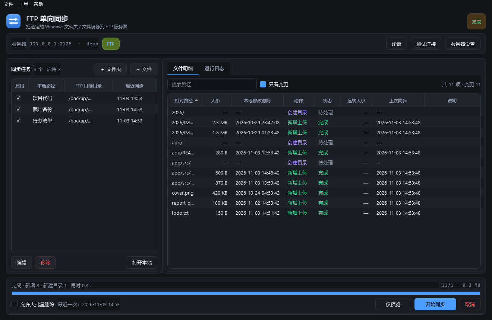
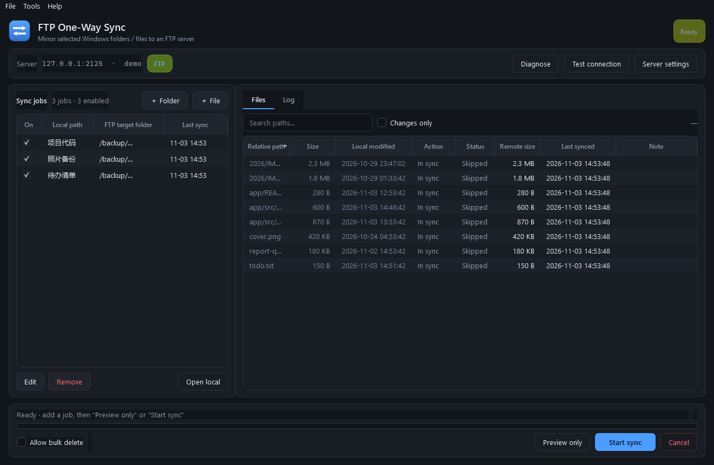
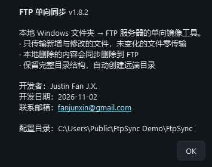
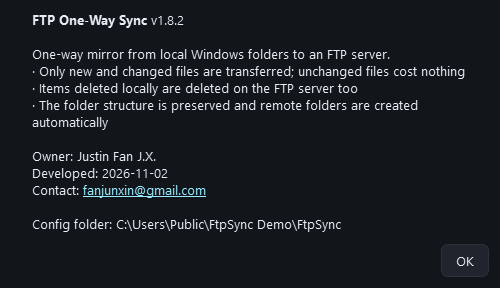

# FTP One-Way mirror

**FTP One-Way mirror** (application name: *FTP One-Way Sync* / *FTP 单向同步*) mirrors selected
Windows folders or files **one way** onto an FTP or FTPS server. It is a portable PySide6 desktop
app: one self-contained `.exe`, no installation, no administrator rights.

What makes it different from a plain `rsync`/script job:

* **Incremental** — unchanged files are never re-transferred, backed by a local SQLite state cache.
* **One-way mirror** — items deleted locally are deleted on the server too (optional).
* **Tolerant of cheap FTP servers** — routers, NAS boxes and BusyBox variants that reject
  `OPTS MLST`, lack `MLSD`, have no `MFMT`/`MDTM`, refuse absolute-path `MKD`, limit concurrent
  connections, or only write inside the current directory (TP-LINK).
* **Bilingual UI** — 中文 / English, switchable without restart.
* **Diagnosable** — a *Diagnose* button probes the server capability by capability.



---

## 1. How to run

**Download** `FtpSync.exe` from the [Releases](https://github.com/fanjx000/FTP-One-Way-mirror/releases) page (single file, ~28 MB), or
build it yourself with `build.bat` (see [§9](#9-run-from-source--build-it-yourself)).

```
dist\FtpSync.exe
```

Everything — the Python runtime, Qt and the application itself — is packed into **that one
file**. There is no `_internal` folder, no DLLs to keep beside it, nothing to install, and it
leaves nothing behind in the registry.

**Check the version first**: the window title, **Help → About** and the first line of every run
log show `程序版本 v1.8.2` (*App version v1.8.2*). If that line is missing, you are running an
old exe.

* The file can be copied to any USB stick or folder and started from there.
* No installer, no registry writes, no Windows service, no admin rights; it touches files with
  the credentials of the current Windows user.
* Supports Windows 11 / Windows 10 (x64).

> **Start-up time.** A single-file build unpacks itself into `%TEMP%\_MEIxxxxx` on every launch
> and removes that folder again on exit. From a **local disk** start-up takes about **2–4 s**.
> If you keep the exe on a **network share** (a mapped NAS drive, for example), Windows has to
> pull ~29 MB over SMB each time, which makes start-up take **30 s or more** — copying the file
> to `C:\Tools\FtpSync\` avoids that wait entirely.

---

## 2. Credits

| Item | Value |
| --- | --- |
| Owner | **Justin Fan J.X.** |
| Development Date | 2026-11-02 |
| Contact Email | [fanjunxin@gmail.com](mailto:fanjunxin@gmail.com) |
| Version | Window title bar, **Help → About**, first log line |

These values live in `app/__init__.py` (`__author__` / `__dev_date__` / `__email__` /
`__version__`); the text shown in the program is built in `app/about.py`, so there is exactly one
place to edit. They also appear in the exe's file properties (right-click → Properties → Details).

`FtpSync.exe --about` prints the same block — handy for support mails. The frozen build is a
windowed program without a console, so with no console attached the text is written to
`%APPDATA%\FtpSync\about.txt` instead; you can also pass a path:
`FtpSync.exe --about about.txt`.

## 3. Interface language

Two UI languages are available: **中文** and **English**.

* Where: **Settings → General → Language** (服务器设置 → 常规 → 界面语言).
* Applies immediately — the window reloads itself, no restart needed.
* The choice is saved in the config file and reused on the next start.
* File-detail actions and statuses, the run log and every error message switch as well.

| Chinese UI | English UI |
| --- | --- |
|  |  |

| About (Chinese) | About (English) |
| --- | --- |
|  |  |

## 4. Quick start (5 steps)

1. **Server settings** — click *服务器设置* (top right) → enter host, port, user, password →
   press *测试连接* (Test connection) to confirm the credentials → save.
   * Plain FTP: choose `FTP`. Encrypted: `FTPS (explicit TLS)`. Synology / many NAS boxes want
     `FTPS (implicit TLS, 990)`.
   * With a self-signed certificate, leave *校验证书* (Verify certificate) off.
2. **Add a job** — click *＋ 文件夹* or *＋ 文件*, pick the local path, then *浏览远端…* to choose
   the target folder on the server (typing it manually works too).
3. **Preview only** (strongly recommended the first time) — compares without writing anything and
   lists every *new / updated / deleted / unchanged* entry.
4. **Start sync** — performs the uploads and deletions; the progress bar, per-file status and
   timestamps update live.
5. Next time just press *开始同步* again — **unchanged files are never re-transferred**.

---

## 5. The window

| Area | Description |
| --- | --- |
| Server bar (top) | Current server, account, protocol; *诊断* (Diagnose), *测试连接*, *服务器设置* |
| *同步任务* (left) | `local path → FTP folder` per job; the *启用* check box decides whether it takes part; double-click to edit |
| *文件明细* (right) | One row per file: relative path, size, local mtime, action, status, remote size, last sync time, note. Searchable, “changed only” filter, sortable headers |
| *运行日志* (right) | Full run log for troubleshooting (copyable) |
| Bottom bar | *仅预览* (Preview only), *开始同步* (Start sync), *取消* (Cancel), progress, *允许大批量删除* |

Dialogs:

* **Server settings** — three tabs: Server (protocol / encoding / concurrency / timeout),
  Sync options, Exclusions.
* **Choose remote folder** — browse the remote tree, create folders.
* **Add / edit job** — local path, remote target, display name, enabled flag.

Screenshots in `docs/`:

| File | Content |
| --- | --- |
| `screenshot-synced.png` | After the first sync (file details + status + timestamps) |
| `screenshot-nodiff.png` | Second run: everything “unchanged”, zero transfer |
| `screenshot-log.png` | Run log |
| `screenshot-settings.png` | Server settings (incl. the General tab with the language selector) |
| `screenshot-options.png` | Sync options tab |
| `screenshot-en.png` | English main window |
| `screenshot-settings-en.png` | English server settings |
| `screenshot-about.png` / `screenshot-about-en.png` | About box (owner / development date / contact) |
| `screenshot-job.png` | Add-job dialog |

---

## 6. Sync rules (the important part)

### 6.1 Incremental decision: only what is necessary

For every file, in this order:

1. **Local state cache** — if the file was uploaded successfully last time and its local
   `size + mtime` are unchanged → skip.
2. **Remote check** — remote size differs → upload; remote mtime differs by more than 2 s → upload.
3. Otherwise → skip (zero transfer).

Remote files that were changed by someone else (size / timestamp not matching the record) are
detected and re-uploaded so the mirror stays correct.

> A second run over a large unchanged folder performs **one remote listing (`MLSD`)** and
> **transfers no file data at all**.

### 6.2 One-way mirror

* New locally → uploaded.
* Changed locally → overwritten on the server.
* Deleted locally → **deleted on the server** (can be switched off in the settings).
* Directory structure is reproduced exactly; missing remote folders are created level by level.

### 6.3 Timestamps

After a successful upload the local mtime is written to the server with `MFMT`, so the next
comparison can rely on metadata alone.

On old servers without `MFMT` / `MDTM` there is no usable remote timestamp; the tool then compares
against the `local size + mtime` recorded at the last successful upload — so **an edit that keeps
the same size is still detected and re-uploaded**.

### 6.4 Safety rails

| Rail | Behaviour |
| --- | --- |
| **Bulk-delete guard** | If a run would delete more than 20 % of the remote entries (and at least 10 items), deletions are **skipped** and a warning is logged. Review the preview, then tick *允许大批量删除* to proceed |
| **Missing source path** | The job fails immediately; remote content is **never** treated as “extra” and deleted |
| **Delete scope** | Deletions only happen *inside* the configured target folder — the target itself is never removed |
| **Symlinks / junctions** | Skipped by default, preventing loops and escapes from the tree |

### 6.5 Compatibility with “quirky” FTP servers

| Server behaviour | What the tool does |
| --- | --- |
| Rejects `OPTS MLST` (501 — routers/NAS/BusyBox) | Uses the default `MLSD` attributes and keeps using MLSD; no downgrade, no error |
| No `MLSD` at all (500/502/504) | Falls back to parsing `LIST`, filling timestamps via `MDTM` |
| `MLSD` returns no file size | Falls back to `LIST` (which always carries sizes) |
| No `MFMT` | Skips writing timestamps, relies on the local state cache |
| Only one transfer at a time (extra connections get 505 / 421) | Retries one at a time on a single connection and lowers this run's concurrency to 1 |
| `MKD` refuses absolute paths (550) | Switches to “CWD into the parent + relative name” and remembers it |
| Folder already exists but both `MKD` and `CWD` answer 550 | Decides existence from the **parent listing** instead of reporting a bogus failure |
| **`STOR`/`DELE` only work inside the current directory** (TP-LINK routers etc.) | Switches into the file's parent folder before every file command, then uses the bare name |
| Rejects certain folder names (`MKD` 505/550) | Names the offending folder and its reason, then skips the files below it instead of hammering each one |
| No `MDTM` | No timestamp resolution; uses size + local state cache |
| Paths must be quoted | On the first 500/501 it retries with quotes and remembers the convention |

### 6.6 Performance

* One recursive `MLSD` returns every remote size and timestamp — no per-file `SIZE`/`MDTM`
  (servers without MLSD fall back to `LIST` parsing plus `MDTM`).
* The SQLite state cache makes repeat runs a pure metadata comparison.
* Directory-creation results are cached per connection, avoiding repeated `MKD`.
* Uploads run in parallel over independent control connections (default 3, configurable 1–8).
* State writes and UI events are batched, so even a hundred-thousand-file tree stays responsive.

---

## 7. Where configuration lives

By default `%APPDATA%\FtpSync\` of the current user:

| File | Content |
| --- | --- |
| `config.json` | Server, options, job list |
| `state.db` | Local state cache of synced files (deleting it only causes a full re-compare) |
| `crash.log` | Crash / stall log (rotated at 512 KB) |
| `about.txt` | Written by `--about` when no console is attached |

**Portable mode**: place an empty file named `portable.txt` next to `FtpSync.exe` and the config
goes to `.\data\` instead — convenient on a USB stick.

**Password security**: the FTP password is encrypted with Windows DPAPI and can only be decrypted
by the same Windows user on the same machine. There is no plain-text password on disk.

---

## 8. Troubleshooting

**OneDrive / cloud folders**
* OneDrive “Files On-Demand” entries are placeholders; reading one triggers a download. A folder
  full of un-downloaded files makes the first sync slow and bandwidth-hungry — the log warns
  “N cloud placeholders not downloaded yet”.
* To sync **only what is already on this disk**: Settings → Sync options → tick
  *不下载 OneDrive 未缓存的云端文件*. Un-downloaded files are then not uploaded.

**Run “Diagnose” first**
Click *诊断* in the server bar (or Tools → Server diagnostics). It probes each item:

1. Connection, login, current folder
2. Listing method: MLSD / LIST / NLST
3. Folder creation: absolute path / CWD + relative name / quoted path
4. Uploading and deleting a test file
5. `MFMT` / `MDTM` timestamps
6. **Every job's target folder**: exists? sub-folder creatable? writable?

The report marks items ✔ / ! / ✘ and ends with a conclusion such as “folder creation must use
rel” or “sync target is usable”. No failing step can make the report empty — it always appears.

The report goes to the run log and can be copied. It can also be produced headless:

```bat
FtpSync.exe --diag diagnose.txt
```

Note: on routers and NAS boxes the FTP **root folder is often read-only** (`/` cannot be written)
while `/volume(xxx)/...` is writable. The report covers both separately, so “root not writable” is
normal and does not mean the sync will fail.

**TP-LINK router / some NAS: every upload returns 550 Permission denied**
Such servers **only accept writes for files inside the *current* directory**: even with a full
absolute path, an existing folder and write permission, `STOR` answers `550 Permission denied`
unless the session has `CWD`-ed into that folder.

Since v1.5.0 every file operation (upload, delete, rename, size lookup) first switches to the
file's parent folder and then uses the bare file name. Verified against a real TP-LINK router:
uploads (including spaces, Chinese names and sub-folders), a second run with zero transfer, and
mirrored deletions all behave correctly.

**“Preview only” leaves the window unresponsive (spinning, no clicks) but the app does not quit**
Two defects causing this were fixed in v1.8.0:

1. Event handling had no time limit. A single preview pushes thousands of row updates and log
   lines; the old drain loop was limited by *item count*, so under a burst it occupied the main
   thread for seconds and Windows flagged the window as “not responding”. Now each 70 ms tick
   occupies the main thread for at most 30 ms and the remainder waits for the next tick, so the
   window always reacts to clicks.
2. Completion depended on “the event queue is empty”. If one more event arrived after the worker
   stopped, the queue never emptied and the buttons stayed grey forever. Completion now depends on
   the worker thread having finished.

A **responsiveness watchdog** was added as well: if the main thread stops turning for more than
5 seconds it is recorded in the crash log, and once the window recovers the buttons are unlocked
and the log says “the window was briefly unresponsive and has recovered”.

**Clicking Help → About does nothing**
Fixed in v1.8.2: the dialog code concatenated `data_dir()` (a `pathlib.Path`) to a
string, which raised `TypeError`; the slot guard swallowed it into the crash log, so the
UI stayed silent.

The guard was improved as well: a failing slot no longer just writes a log line — it now
shows *刚才的操作出错了，程序已继续运行* ("the last action failed, the app is still
running") with the stack, at most once every 20 s per slot. So any button or menu item
that stops working tells you instead of doing nothing.

**The app quits by itself / crashes**
Since v1.7.0 every exception is recorded and caught, and the program keeps running:

* a dialog says *刚才的操作出错了，程序已继续运行* with the full stack;
* the same information goes to `%APPDATA%\FtpSync\crash.log` (rotated at 512 KB);
* **Help → View crash log** shows and copies it;
* hard crashes (C-level abort / segfault) leave a stack trace via `faulthandler`.

Two confirmed crash sites were fixed:

1. Closing the settings dialog while “Test connection” was still running — a `QThread` destroyed
   while running makes Qt `abort()` the whole process (now a plain thread plus a queued signal,
   no ownership problem);
2. Rebuilding the window after a language switch — the new window was only referenced by the old
   one, so it died with it and the app exited (now kept alive by a module-level reference, and no
   rebuild happens while a sync is running).

**Am I running the latest build?**
Window title = `FTP 单向同步  v1.8.2`; first log line = `程序版本 v1.8.2`. If either is missing you
opened an exe from an old folder.

**505 / 550 “Permission denied” while uploading**
1. Read the *Failure details* block in the log — it groups errors with the code, sample files and
   a likely cause.
2. If every upload fails but folder creation worked, the server probably limits concurrent
   connections: the tool retries on a single connection automatically. Set *同时上传的文件数*
   (parallel uploads) to 1 once the retry succeeds.
3. If the log says “failed to create folder xxx”, the server rejects that folder name (special
   characters, path too long, no write permission). Files below it are skipped and the log names
   the folder.

**501 Option not understood (fixed in older versions)**
* The server does not understand `OPTS MLST`. Current builds degrade automatically, no setting
  needed. If it still appears, make sure you run the latest `dist\FtpSync.exe`.

**Cannot connect / keeps timing out**
* Try turning *被动模式* (passive mode) off — a few intranet servers only support active mode.
* Check that the firewall allows the FTP port and the passive port range.
* *测试连接* reports the exact cause (DNS, timeout, refused, login failure, TLS handshake failure).

**FTPS certificate error**
* NAS boxes usually use self-signed certificates: untick *校验证书* in the server settings.

**Garbled Chinese file names**
* Switch the server encoding to `GBK` (some Chinese / old IIS FTP services) or `UTF-8`
  (recommended, works on the vast majority of servers).

**No permission**
* Check that the FTP account may write to and delete inside the target folder; each failure is
  listed row by row with status *失败*.

**See what would be deleted**
* Press *仅预览* first, tick *只看变更* and look at the rows whose action is *删除* (delete).

---

## 9. Run from source / build it yourself

```bat
pip install PySide6-Essentials pyinstaller
python run.py            :: run the sources directly
build.bat                :: build the single-file dist\FtpSync.exe
```

`build.bat` uses `FtpSync-onefile.spec`, which packs the runtime, Qt and the application into one
executable (no `_internal` folder). `FtpSync-folder.spec` (the previous layout) is still there if
you prefer a folder build for faster start-up on a network share.

Automated tests start a local FTP server and cover first sync, zero-transfer repeat runs,
modify/add/delete, timestamps, the bulk-delete guard, single-file jobs and broken source paths:

```bat
pip install pyftpdlib pyopenssl
python tools\test_sync.py           :: 9 core scenarios
python tools\test_505.py            :: concurrency-limited / rejected folder name (505)
python tools\test_mkdir_modes.py    :: three folder-creation dialects (absolute / relative / exists)
python tools\test_about.py          :: Help -> About really opens, slot failures are reported
python tools\test_diagnose.py       :: the diagnostics itself never throws
python tools\test_crash_safety.py   :: injected slot errors, closing a dialog mid-test, bad indexes
python tools\test_ui_response.py    :: event storms, never-empty queue, frozen main thread
python tools\test_i18n.py           :: English UI + English log completeness
python tools\test_variants.py       :: explicit FTPS + a server without MLSD
python tools\test_exe.py            :: end-to-end run of the built exe
python tools\test_quirky_server.py  :: 501 OPTS / no MLSD / no timestamps + cloud placeholders
python tools\test_exe_quirky.py     :: built exe against a “router-style” server
python tools\ui_audit.py            :: layout audit (two window sizes, both languages)
```

| Script | Coverage |
| --- | --- |
| `test_sync.py` | Preview writes nothing, first sync, zero-transfer repeat, modify/add/delete, same size + new mtime, remote tampering corrected, bulk-delete guard, single-file job, broken source path does not delete |
| `test_variants.py` | Explicit FTPS (self-signed), fallback to `LIST` + `MDTM` without `MLSD` |
| `test_exe.py` | Built exe: real upload, Chinese file names, incremental, mirrored delete, window rendering |
| `test_quirky_server.py` | `OPTS MLST`→501, no `MLSD`, no `MFMT`/`MDTM`, spaces/Chinese in paths, OneDrive placeholders, junctions |
| `test_exe_quirky.py` | Built exe against a router-style server |
| `test_505.py` | Concurrency-limited server (extra `STOR` → 505), rejected folder name (`MKD` 505) |
| `test_i18n.py` | No Chinese left in the English UI, English run log, switching back, instant rebuild |
| `test_mkdir_modes.py` | Relative-only `MKD`, `CWD` forbidden, existing folder where `MKD` and `CWD` both answer 550 |
| `test_about.py` | Help → About really opens in both languages, required fields present, slot failures reported |
| `test_diagnose.py` | Diagnostics never raise: read-only account, healthy server, dropped connection, unreachable host, read-only root, unwritable target |
| `test_crash_safety.py` | Slot exceptions, closing the dialog during a test, out-of-range indexes, window kept alive on language switch, crash log |
| `test_ui_response.py` | 5000 events without freezing, finishing with a never-empty queue, recovery after a 6 s freeze, repeated previews |
| `ui_audit.py` | Squeezed text / overlapping widgets / truncated table cells |

## 10. Repository layout and licence

```
app/          application package (see below)
tools/        test suites, screenshot and packaging helpers
docs/         screenshots used by this README
.github/      CI: tests on Windows + a built single-file exe as artifact
FtpSync-onefile.spec   default build (one file)
FtpSync-folder.spec    optional folder build (faster start from a network share)
build.bat              one-command build
run.py                 run from source
CHANGELOG.md           version history
PUBLISH.md             how this repository is published / released
```

Released under the **MIT licence** — see [LICENSE](LICENSE).
Owner: **Justin Fan J.X.** · developer date 2026-11-02 · [fanjunxin@gmail.com](mailto:fanjunxin@gmail.com).

Contributions are welcome: keep the test suites green (`python tools\test_*.py`), keep user-facing
strings translatable through `app/i18n.py`, and add a CHANGELOG entry.

### Code layout

```
app/
  models.py     data structures (job, file row, summary)
  config.py     config read/write (JSON) + DPAPI password
  dpapi.py      Windows Data Protection API wrapper
  ftpclient.py  FTP/FTPS session: recursive listing, mkdir, upload, MFMT, delete
  scanner.py    local scan (exclusions, symlinks, hidden files)
  state.py      sync state cache (SQLite)
  engine.py     diff + one-way mirror execution (parallel upload, safety rails)
  about.py      About-box content (single source for GUI and --about)
  i18n.py       zh/en string table (Chinese original is the key, falls back to Chinese)
  safety.py     crash guards: exception hooks / crash log / slot guards / faulthandler
  diagnose.py   server capability diagnostics
  ui/           widgets: main window, dialogs, table model, theme, icon
tools/          test and build helper scripts
```
